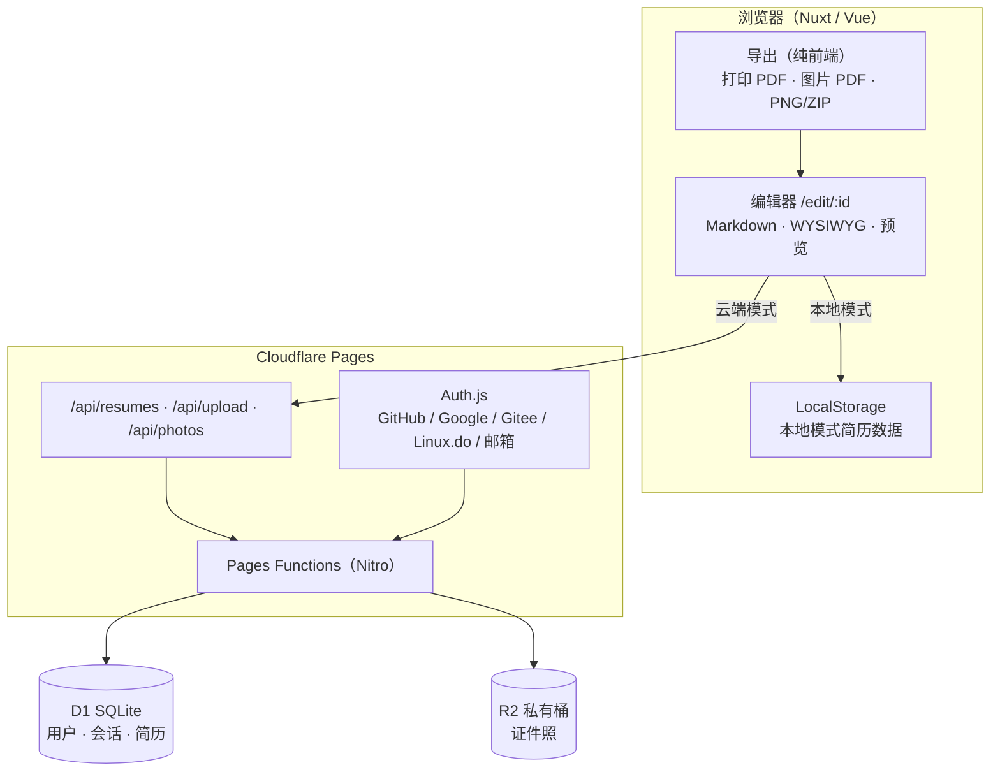

<p align="center">

</p>

<h1 align="center">MARK RESUME</h1>

<p align="center">
<a href="README_US.md"></a><a href="https://resume.ryanuo.cc" target="_blank">

</a><a href="https://github.com/NxResume/DualMode-ResumeEditor"></a>
<a href="https://ryanuo.cc/zh/posts/resume"></a>
<a href="https://deepwiki.com/NxResume/DualMode-ResumeEditor"></a>
</p>

一个基于 Nuxt 4 & Vue 3 的现代化、功能丰富的简历编辑器，支持 Markdown/WYSIWYG 双模式、第三方登录、本地与云端双存储、主题切换、PDF/图片/ZIP 导出、PWA 离线、国际化等特性。

## 🌟 主要特性

- **GitHub / Google / Gitee / Linux.do 登录**，并支持邮箱密码注册登录，多端同步
- **Markdown 编辑 & 实时预览**，支持所见即所得与源码切换；左右滚动可按源码行锚点跟随对齐
- **多主题切换**（独立包 `resume-theme`），内置多款美观主题，支持主题色 / 背景自定义
- **多种导出方式**：打印为 PDF（推荐，浏览器另存）、图片式 PDF、单页 PNG / 多页 ZIP
- **证件照上传与编辑**，支持拖拽、缩放、重置（云端存 R2，本地存 `.data/r2-photos`）
- **字体选择与自定义上传**，导出时尽量保留字体
- **中英文界面一键切换**，自动检测浏览器语言
- **PWA 支持**，可安装为桌面/移动端应用，离线编辑
- **本地 / 云端双存储**，可在设置中切换并迁移数据
- **编辑器侧栏插件面板**（主题、字体、页边距、证件照、导出等），便于扩展

## ⚙️ 环境变量说明

请根据实际部署环境，参考下方模板创建 `.env` 文件（也可见仓库根目录 `.env-example`）。

| 变量名                | 说明                                                         |
| --------------------- | ------------------------------------------------------------ |
| AUTH_SECRET           | Session 加密密钥，建议用 openssl 生成                        |
| AUTH_ORIGIN           | Auth 回调根地址（如 `http://localhost:3000/api/auth`）       |
| GITHUB_CLIENT_ID      | GitHub OAuth 应用 Client ID                                  |
| GITHUB_CLIENT_SECRET  | GitHub OAuth 应用 Client Secret                              |
| GOOGLE_CLIENT_ID      | Google OAuth 应用 Client ID                                  |
| GOOGLE_CLIENT_SECRET  | Google OAuth 应用 Client Secret                              |
| GITEE_CLIENT_ID       | Gitee OAuth 应用 Client ID                                   |
| GITEE_CLIENT_SECRET   | Gitee OAuth 应用 Client Secret                               |
| LINUXDO_CLIENT_ID     | Linux.do OAuth 应用 Client ID                                |
| LINUXDO_CLIENT_SECRET | Linux.do OAuth 应用 Client Secret                            |
| MAIL_USER             | 邮箱账号（注册验证码发信，可选）                             |
| MAIL_PASS             | 邮箱密码 / 授权码                                            |
| HTTPS_PROXY           | HTTPS 代理（可选，本地访问被墙 OAuth 时有用）                |
| HTTP_PROXY            | HTTP 代理（可选）                                            |

> 生产环境 D1 / R2 通过 `wrangler.jsonc` 绑定注入（`DB`、`PHOTOS`），无需 `DATABASE_URL`。

## 🚀 快速开始

1. 安装依赖

   ```bash
   pnpm install
   ```

2. 配置环境变量（见上文，直接创建 `.env` 即可）
3. 初始化本地数据库（SQLite，生成 `.data/resume.db`）
   ```bash
   pnpm db:push
   ```
4. 启动开发服务器
   ```bash
   pnpm dev
   ```
   访问 [http://localhost:3000](http://localhost:3000)

## ☁️ 部署（Cloudflare Pages + D1 + R2）

生产环境部署在 Cloudflare Pages（Functions），数据库为 Cloudflare D1，证件照等图片走私有 R2 桶。

```bash
# 1. 创建 D1 数据库（仅首次；已创建：resume）
wrangler d1 create resume

# 2. 创建 R2 桶（仅首次；已创建：resume-photos）
wrangler r2 bucket create resume-photos

# 3. 应用表结构到远程 D1
pnpm db:d1:apply

# 4. 构建并部署
pnpm deploy:cf
```

Secrets（`AUTH_SECRET`、OAuth Client ID/Secret、`MAIL_USER` / `MAIL_PASS` 等）在 Pages Dashboard → Settings → Environment variables 配置，不进 git。公开变量如 `AUTH_ORIGIN` 可写在 `wrangler.jsonc` 的 `vars` 中。

## 📄 PDF / 图片导出

全部在浏览器端完成，**无独立导出微服务**（无 Playwright / Render 等后端）。

| 模式 | 实现 | 特点 |
|------|------|------|
| **打印为 PDF（推荐）** | 隐藏 iframe + 浏览器打印对话框（另存为 PDF） | 版式一比一、文字可选；请取消「页眉和页脚」，边距选「无」 |
| **导出 PDF（图片）** | `html-to-image` → JPEG → `jsPDF` | 所见即所得稳，文件较大，文字不可选 |
| **导出图片** | `html-to-image` → PNG；多页则 `jszip` 打包 | 单页 PNG，多页 ZIP |

## 📖 使用指南

- 首页 `/`：功能介绍、主题预览
- 我的简历 `/resumes`：管理简历（云端模式需登录）
- 编辑器 `/edit/:id`：左侧 Markdown，右侧实时预览；侧栏设置主题 / 字体 / 跟随滚动等
- 预览 `/preview/:id`：只读预览与导出
- 登录 `/signin`：第三方登录或邮箱密码

## 🏗️ 技术栈

- **前端**：Nuxt 4, Vue 3, Pinia, CodeMirror, Markdown-it, UnoCSS, shadcn-vue
- **主题**：[`resume-theme`](https://www.npmjs.com/package/resume-theme)（独立主题包）
- **后端 / 部署**：Nitro（本地 `node-server` / 生产 Cloudflare Pages Functions）
- **数据库**：Drizzle ORM + SQLite（本地 `better-sqlite3` → `.data/resume.db`；生产 Cloudflare D1）
- **对象存储**：Cloudflare R2（证件照；本地回退 `.data/r2-photos`）
- **认证**：@sidebase/nuxt-auth（Auth.js），GitHub / Google / Gitee / Linux.do / Credentials
- **导出**：浏览器打印、jsPDF、html-to-image、jszip（纯前端）
- **PWA**：@vite-pwa/nuxt
- **国际化**：@nuxtjs/i18n

## 🖇️ 系统架构



本地开发时：Functions 跑在 Node 上，D1 换成 `.data/resume.db`（better-sqlite3），R2 换成 `.data/r2-photos/`。

## 🤝 贡献与许可

- 欢迎 Issue、PR 与建议，MIT License
- 作者：RYANUO（https://github.com/ryanuo）
