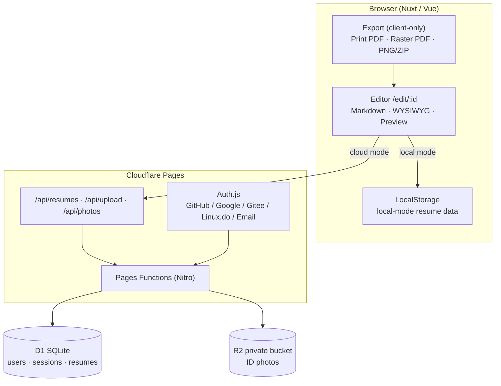

<p align="center">

</p>

<h1 align="center">MARK RESUME</h1>

<p align="center">
<a href="README.md"></a><a href="https://resume.ryanuo.cc" target="_blank">

</a><a href="https://github.com/NxResume/DualMode-ResumeEditor"></a>
<a href="https://ryanuo.cc/posts/resume"></a>
<a href="https://deepwiki.com/NxResume/DualMode-ResumeEditor"></a>
</p>

A modern, feature-rich resume editor built with Nuxt 4 & Vue 3, supporting Markdown/WYSIWYG dual mode, third-party login, dual local/cloud storage, theme switching, PDF/image/ZIP export, PWA offline, and i18n.

## 🌟 Features

- **GitHub / Google / Gitee / Linux.do OAuth**, plus email/password registration and login, for multi-device sync
- **Markdown editing & real-time preview** (WYSIWYG/source switch); optional left–right scroll sync by source-line anchors
- **Multiple themes** via the standalone [`resume-theme`](https://www.npmjs.com/package/resume-theme) package; theme color / background customization
- **Multiple export modes**: Print as PDF (recommended, browser Save as PDF), raster PDF, single-page PNG / multi-page ZIP
- **ID photo upload & edit**, drag/scale/reset (cloud: private R2; local: `.data/r2-photos`)
- **Font selection & custom upload**, fonts preserved as much as possible on export
- **One-click English/Chinese switch**, auto-detect browser language
- **PWA support**, installable as desktop/mobile app, offline editing
- **Dual local/cloud storage**, switch and migrate data from the UI
- **Editor sidebar plugin panel** (theme, font, padding, photo, export, etc.) for easy extension

## ⚙️ Environment Variables

Create a `.env` file based on your deployment environment (see also `.env-example` in the repo root).

| Variable              | Description                                                |
| --------------------- | ---------------------------------------------------------- |
| AUTH_SECRET           | Session encryption secret (use openssl)                    |
| AUTH_ORIGIN           | Auth callback root (e.g. `http://localhost:3000/api/auth`) |
| GITHUB_CLIENT_ID      | GitHub OAuth App Client ID                                 |
| GITHUB_CLIENT_SECRET  | GitHub OAuth App Client Secret                             |
| GOOGLE_CLIENT_ID      | Google OAuth App Client ID                                 |
| GOOGLE_CLIENT_SECRET  | Google OAuth App Client Secret                             |
| GITEE_CLIENT_ID       | Gitee OAuth App Client ID                                  |
| GITEE_CLIENT_SECRET   | Gitee OAuth App Client Secret                              |
| LINUXDO_CLIENT_ID     | Linux.do OAuth App Client ID                               |
| LINUXDO_CLIENT_SECRET | Linux.do OAuth App Client Secret                           |
| MAIL_USER             | Mail account (registration verification email, optional)   |
| MAIL_PASS             | Mail password / app token                                  |
| HTTPS_PROXY           | HTTPS proxy (optional; useful for blocked OAuth endpoints) |
| HTTP_PROXY            | HTTP proxy (optional)                                      |

> Production D1 / R2 are injected via `wrangler.jsonc` bindings (`DB`, `PHOTOS`). No `DATABASE_URL` is required.

**Local development template:**

```env
AUTH_SECRET=
AUTH_ORIGIN=http://localhost:3000/api/auth
GITHUB_CLIENT_ID=
GITHUB_CLIENT_SECRET=
GOOGLE_CLIENT_ID=
GOOGLE_CLIENT_SECRET=
GITEE_CLIENT_ID=
GITEE_CLIENT_SECRET=
LINUXDO_CLIENT_ID=
LINUXDO_CLIENT_SECRET=
MAIL_USER=
MAIL_PASS=
```

**Production template:**

```env
AUTH_SECRET=
AUTH_ORIGIN=https://your-domain.com/api/auth
GITHUB_CLIENT_ID=
GITHUB_CLIENT_SECRET=
GOOGLE_CLIENT_ID=
GOOGLE_CLIENT_SECRET=
GITEE_CLIENT_ID=
GITEE_CLIENT_SECRET=
LINUXDO_CLIENT_ID=
LINUXDO_CLIENT_SECRET=
MAIL_USER=
MAIL_PASS=
HTTPS_PROXY=
HTTP_PROXY=
```

## 🚀 Quick Start

1. Install dependencies
   ```bash
   pnpm install
   ```
2. Configure environment variables (see above; just create a `.env` file)
3. Initialize local database (SQLite, creates `.data/resume.db`)
   ```bash
   pnpm db:push
   ```
4. Start development server
   ```bash
   pnpm dev
   ```
   Visit [http://localhost:3000](http://localhost:3000)

## ☁️ Deployment (Cloudflare Pages + D1 + R2)

Production runs on Cloudflare Pages (Functions) with Cloudflare D1 for data and a private R2 bucket for photos.

```bash
# 1. Create the D1 database (first time only; already created: resume)
wrangler d1 create resume

# 2. Create the R2 bucket (first time only; already created: resume-photos)
wrangler r2 bucket create resume-photos

# 3. Apply the schema to remote D1
pnpm db:d1:apply

# 4. Build and deploy
pnpm deploy:cf
```

Secrets (`AUTH_SECRET`, OAuth Client ID/Secret, `MAIL_USER` / `MAIL_PASS`, etc.) are configured in Pages Dashboard → Settings → Environment variables, not committed to git. Public vars such as `AUTH_ORIGIN` may live in `wrangler.jsonc` `vars`.

## 📄 PDF / Image Export

All export runs in the browser. **There is no separate export microservice** (no Playwright / Render backend).

| Mode                           | Implementation                                     | Notes                                                                      |
| ------------------------------ | -------------------------------------------------- | -------------------------------------------------------------------------- |
| **Print as PDF (Recommended)** | Hidden iframe + browser print dialog (Save as PDF) | 1:1 layout, selectable text; uncheck “Headers and footers”, margins “None” |
| **Export PDF (Image)**         | `html-to-image` → JPEG → `jsPDF`                   | WYSIWYG-stable; larger files; text not selectable                          |
| **Export Image**               | `html-to-image` → PNG; multi-page via `jszip`      | Single-page PNG, multi-page ZIP                                            |

## 📖 Usage Guide

- Home `/`: Feature intro, theme preview
- My Resumes `/resumes`: Manage resumes (login required in cloud mode)
- Editor `/edit/:id`: Markdown left, live preview right; sidebar for theme / font / follow-scroll, etc.
- Preview `/preview/:id`: Read-only preview and export
- Sign in `/signin`: Third-party or email/password login

## 🏗️ Tech Stack

- **Frontend**: Nuxt 4, Vue 3, Pinia, CodeMirror, Markdown-it, UnoCSS, shadcn-vue
- **Themes**: [`resume-theme`](https://www.npmjs.com/package/resume-theme) (standalone package)
- **Backend / Deploy**: Nitro (local `node-server` / production Cloudflare Pages Functions)
- **Database**: Drizzle ORM + SQLite (local `better-sqlite3` → `.data/resume.db`; production Cloudflare D1)
- **Object storage**: Cloudflare R2 (ID photos; local fallback `.data/r2-photos`)
- **Auth**: @sidebase/nuxt-auth (Auth.js), GitHub / Google / Gitee / Linux.do / Credentials
- **Export**: browser print, jsPDF, html-to-image, jszip (client-only)
- **PWA**: @vite-pwa/nuxt
- **i18n**: @nuxtjs/i18n

## 🖇️ System Architecture



In local development, Functions run on Node: D1 is replaced by `.data/resume.db` (better-sqlite3), and R2 by `.data/r2-photos/`.

## 🤝 Contributing & License

- Issues, PRs, and suggestions are welcome. MIT License.
- Author: RYANUO (https://github.com/ryanuo)
